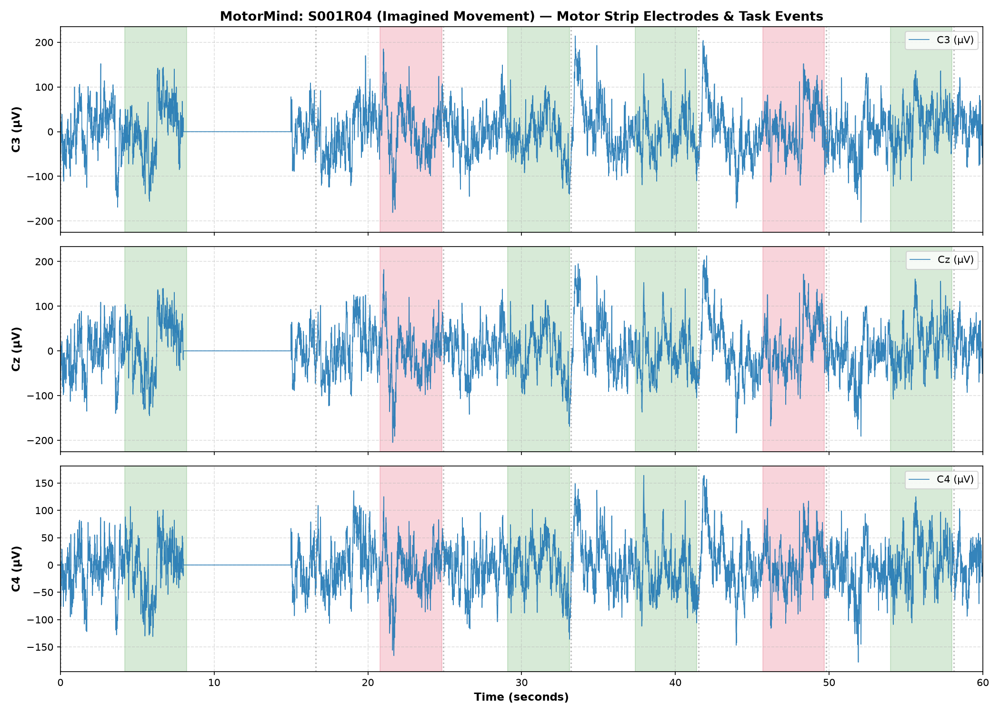
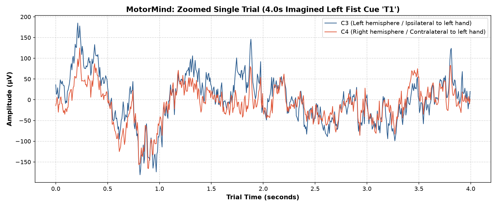
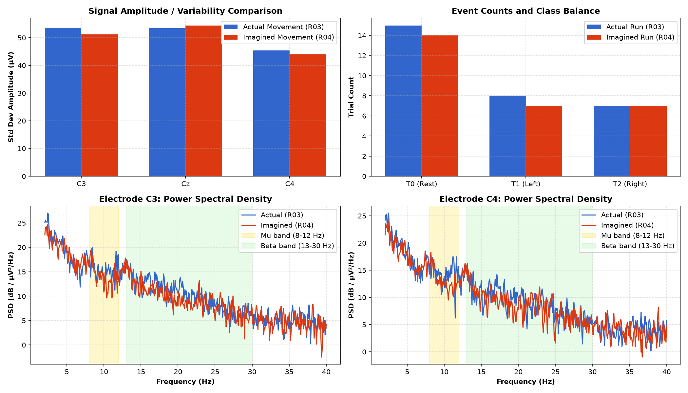
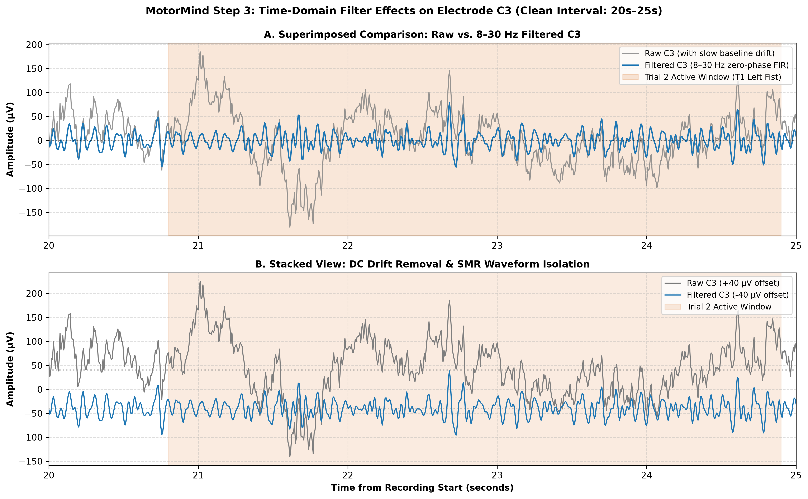
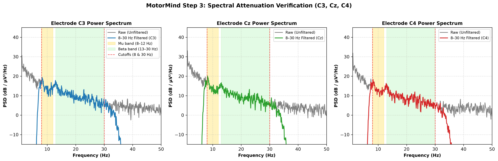
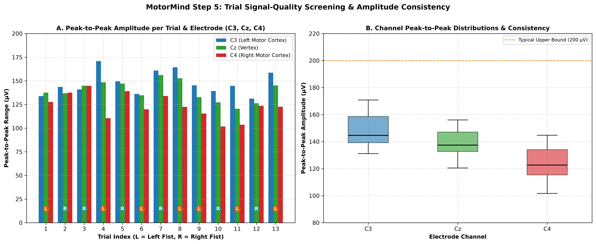

# MotorMind — EEG Motor Imagery Classification

MotorMind is a research-oriented machine-learning project exploring whether EEG signals can distinguish **imagined left-hand movement from imagined right-hand movement**.

The project uses the PhysioNet EEG Motor Movement/Imagery Dataset and focuses on understanding the data, building a reproducible preprocessing pipeline, checking signal quality, and evaluating a classical machine-learning baseline.

> **Status:** Research prototype. Results are preliminary and do not represent a validated real-time brain–computer interface.

## Project Pipeline

1. **Dataset inspection** — inspect EDF recordings, channel information, sampling frequency, and event annotations.
2. **Preprocessing** — apply an 8–30 Hz band-pass filter and select the C3, Cz, and C4 motor-area channels.
3. **Trial extraction** — extract fixed-length EEG windows and associate them with left- or right-imagery labels.
4. **Signal-quality checks** — inspect missing or invalid values, flat signals, and trial-level signal characteristics.
5. **Baseline classification** — evaluate Common Spatial Patterns (CSP) with Linear Discriminant Analysis (LDA).
6. **Evaluation** — use leave-one-subject-out validation to investigate generalization to participants not used for model fitting.

## Visual Results

### 1. Raw EEG and event annotations

### 2. Example EEG trial

### 3. Actual movement versus motor imagery

### 4. Raw and filtered EEG

### 5. Frequency-domain comparison

### 6. Trial signal-quality summary

## Preliminary Baseline Results

The current CSP + LDA evaluation report records:

| Metric | Reported result |
|---|---:|
| Participants evaluated | 69 |
| Held-out trial predictions | 3,013 |
| Pooled accuracy | 59.61% |
| Balanced accuracy | 59.61% |
| ROC AUC | 0.6424 |
| Majority-class accuracy reference | 50.61% |

The report describes leave-one-subject-out validation: each participant is held out in turn while the model is fitted on the other participants.

These are **preliminary reported results**, not an independently reproduced benchmark. Performance varies across participants, and further methodological verification is needed before drawing strong conclusions about generalization.

See the [baseline training report](results/reports/training_report.md), [preprocessing audit](results/reports/preprocessing_audit_report.md), and [confusion matrix](results/figures/confusion_matrix.png).

## Dataset

MotorMind uses the [PhysioNet EEG Motor Movement/Imagery Dataset](https://physionet.org/content/eegmmidb/1.0.0/).

Raw recordings and generated numerical epoch arrays are excluded from Git. Follow the dataset's terms and the project scripts to obtain the required recordings.

## Technologies

- Python
- MNE-Python
- NumPy and SciPy
- pandas
- Matplotlib
- scikit-learn

## Current Limitations

- EEG signals vary substantially between participants.
- Signal artifacts and recording dropouts can affect the usable data.
- Performance on unseen participants may differ from performance after participant-specific calibration.
- The baseline is not a real-time control system and has not been established as suitable for practical BCI use.
- The preprocessing and evaluation pipeline still needs further reproducibility and methodological checks.

## Future Work

- Verify preprocessing and event-label assumptions against the official dataset documentation.
- Reproduce the evaluation from a clean environment.
- Compare frequency bands and classification baselines using a consistent validation protocol.
- Investigate participant-level performance differences and improve signal-quality handling.

---

*MotorMind is an ongoing educational and research project. The goal is to understand each stage of EEG-based classification and document both successful results and limitations.*
